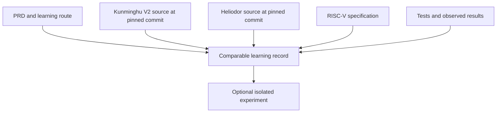

# Architecture Spine — RV64 CPU 双项目学习计划

## Design Paradigm

Evidence-backed comparative learning: each learning unit starts from an architectural behavior, traces both implementations, and records evidence and conclusions in one reviewable note.

## Invariants & Rules

### AD-1 — One feature, one comparable record

- **Binds:** FR-3, FR-4, FR-5, FR-8, SM-1, SM-2
- **Prevents:** Notes for the same feature using different structures, making the two implementations difficult to compare.
- **Rule:** Create one Markdown record per learning unit from a checked-in template. Required frontmatter: `unit_id`, `stage_id`, `scope`, `exclusions`, `spec_refs`, and source snapshot IDs. Required sections, in order: unit self-check (prompt, learner answer, check type and evidence ID), architectural behavior and enumerated subcases, Kunminghu path, Heliodor path, comparison claims, evidence table, learner summary, and open questions. List parameterized subcases (such as widths, masks, exceptions, or privilege modes) explicitly; partial coverage must name the omitted cases. The stage route record indexes each unit's self-check answers and records stage completion; it does not replace them. Save immutable unit revisions as `<unit_id>-vN.md`; an index identifies the current revision.

### AD-2 — Every claim points to a source snapshot

- **Binds:** FR-1, FR-2, FR-7, FR-8
- **Prevents:** A note silently depending on a moving branch or an unverifiable claim.
- **Rule:** Maintain a project snapshot lock assigning stable IDs to the selected Kunminghu V2 (V2R2 documentation/configuration) and Heliodor commits. Each unit references those IDs; a deliberate deviation records its reason and marks cross-unit comparison as not directly comparable. Change the lock only with a dated snapshot-change record. Link every comparison claim to evidence IDs for both implementations. Use evidence kinds `spec`, `design-doc`, `source`, `test-inspected`, `test-run`, or `experiment`, and statuses `inspected`, `run-pass`, `run-fail`, `unverified`, or `not-applicable`. A run entry records exact command, configuration, input/case, expected result, observed result, and artifact/path; `run-pass` requires observed output. Inspection does not imply execution. Record spec edition/version and distinguish mandatory profile requirements from optional items and upstream claims.

### AD-3 — Keep study experiments separate from upstream implementations

- **Binds:** FR-5, FR-8, FR-9
- **Prevents:** Learning experiments being mistaken for upstream code or altering the source under study.
- **Rule:** Do not edit upstream source in place. Put any learner-created harness or experiment under `experiments/<unit>/` and record its source snapshot, inputs, procedure, and observed result.

### AD-4 — Map RVA23 requirements independently from implementation claims

- **Binds:** FR-2, FR-7, SM-3
- **Prevents:** Treating a project README or one test result as proof of complete profile coverage.
- **Rule:** Maintain one row per official mandatory requirement, keyed by its exact identifier and specification revision. Record independent Kunminghu and Heliodor status, implementation location or explicit scope/unavailability decision, rationale, covered subcases, and evidence IDs. Use statuses `not-studied` (in scope but not investigated), `partially-studied`, `studied-unverified`, `evidence-observed`, `not-present` (absence supported by inspected evidence), and `out-of-scope` (explicit learner decision with rationale); `evidence-observed` describes this project's evidence and is not a certification claim. Do not infer full requirement coverage from a subset of tests or from upstream claims. Keep mandatory, optional, and upstream-claimed items distinct.

## Consistency Conventions

| Concern | Convention |
| --- | --- |
| Naming | Use immutable versioned files under `notes/units/`, named `<unit_id>-vN.md`; the unit index points to the current revision. |
| Language | Explanations are in Chinese; ISA mnemonics, extension names, symbols, and source paths retain upstream spelling. |
| Data & references | Store full commit SHAs and stable source paths; add line references or permalinks when available. Never cite a moving branch as the only locator. |
| Verification | Distinguish inspected tests from executed tests; only report a pass when it was run and its result observed. |
| Experiments | Keep optional, learner-authored experiments under `experiments/<unit>/`; do not duplicate upstream source files. |
| Stage completion | Each unit owns its self-check prompt and answer. The stage route record indexes those answers and records completion only after all required checks and at least one explanation, source-location, or test/simulation check have evidence. |

## Stack

| Name | Version |
| --- | --- |
| Markdown / GitHub Flavored Markdown | No runtime version |
| Git (observed planning host version) | 2.43.0 |
| Kunminghu V2 source | Upstream `kunminghu-v2` branch (V2R2 docs/configuration); pin commit in project snapshot lock |
| Heliodor source | Upstream default branch; pin commit in project snapshot lock |

## Structural Seed

```text
learning_rv64_cpu/
├── README.md                         # project orientation and learning route
├── notes/
│   ├── units/                        # immutable <unit_id>-vN records from canonical template
│   ├── units/index.md                # current revision per learning unit
│   └── rva23-coverage.md              # requirement-to-evidence mapping
├── sources.lock                      # stable IDs and exact upstream snapshot SHAs
├── experiments/                      # optional isolated learner experiments
├── _agile-output/planning-artifacts/ # BMad planning documents
└── sources/                          # proposed local upstream checkouts; ignored by Git
```



The `sources/` location is a proposed seed, not an invariant; see Deferred.

## Capability → Architecture Map

| Capability / Area | Lives in | Governed by |
| --- | --- | --- |
| Source snapshot and specification evidence (FR-1, FR-2) | Each learning record; `notes/rva23-coverage.md` | AD-2, AD-4 |
| Feature comparison (FR-3, FR-4, FR-5) | `notes/units/` | AD-1, AD-2 |
| Learning route and stage checks (FR-6, FR-9) | `README.md` and planning artifacts | AD-1, AD-3 |
| RVA23 mandatory-item map (FR-7, SM-3) | `notes/rva23-coverage.md` | AD-2, AD-4 |
| Experiment evidence (FR-8, FR-9) | `experiments/<unit>/` and its learning record | AD-2, AD-3 |

## Deferred

- **Upstream checkout location:** `sources/` within the project is proposed. Confirm repository sizes, disk space, and preferred workspace before cloning; sibling checkouts are also viable. Regardless of location, the snapshot lock and notes pin exact commit SHAs.
- **Host and operations:** During the source/environment stage, record host OS, available disk/memory, isolation approach, where toolchains and generated artifacts live, setup/cleanup steps, exact commands, and retained outputs. If execution is unavailable, record the blocker and use source/spec inspection without labeling behavior as run.
- **Toolchain versions and test commands:** determine during the source/environment stage from the chosen snapshots and available host; keep versions, setup, commands, configuration and artifacts with the experiment that uses them. Owner: project learner. Revisit when the first reproducible run is selected.
- **Study cadence and later unit selection:** decide after the `ADD` pilot, as required by the PRD.
- **Publication format and license review:** decide before sharing notes outside this personal project.
