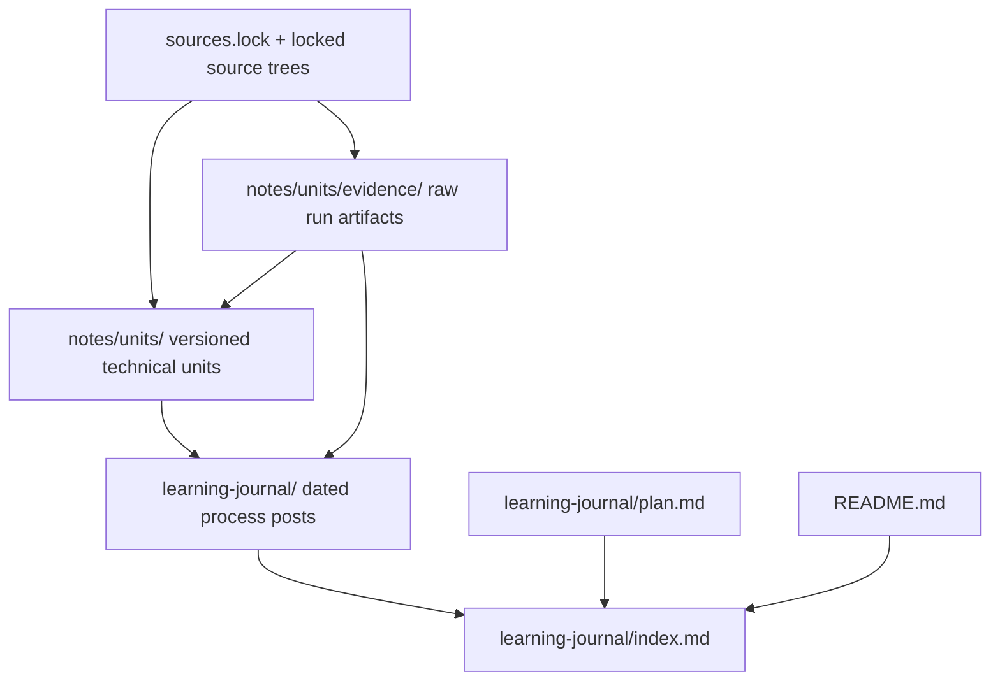

# Architecture Spine — RV64 load/store deep dive

## Design Paradigm

An evidence-driven learning pipeline: locked source snapshots and captured run artifacts support versioned technical units; chronological journal posts link to those units and their evidence. Markdown and Git are the storage and reading surface.

## Invariants & Rules

### AD-1 — Technical findings have one canonical owner [ADOPTED]

- **Binds:** FR-1, FR-2, FR-6
- **Prevents:** Different logs or indexes maintaining conflicting copies of the same technical explanation.
- **Rule:** `notes/units/` owns technical conclusions. Published `<unit_id>-vN.md` files are never edited in place; revisions create the next version, and `notes/units/index.md` points to the current version. `learning-journal/` owns chronology and links to units/evidence without duplicating their findings.

### AD-2 — Comparisons use locked source snapshots [ADOPTED]

- **Binds:** FR-3, FR-4, FR-5, FR-7
- **Prevents:** Conclusions combining evidence from different or drifting upstream revisions.
- **Rule:** Every implementation claim identifies the stable source ID and full SHA from `sources.lock`. Only those locked checkouts count toward this stage's comparison. A changed snapshot requires a dated baseline change record and rechecking affected conclusions.

### AD-3 — Evidence type and validation state are independent [ADOPTED]

- **Binds:** FR-2, FR-3, FR-4, FR-5, FR-6
- **Prevents:** Treating inspected source or a test entry as proof that behavior ran successfully.
- **Rule:** Each evidence row has separate `type` and `status` fields, following [learning-record-conventions.md](../../../specs/spec-learning_rv64_cpu/learning-record-conventions.md). Types are `spec`, `design-doc`, `source`, `test-inspected`, `test-run`, or `experiment`; statuses are `inspected`, `run-pass`, `run-fail`, `blocked`, `unverified`, or `not-applicable`. Every claim links evidence IDs. A missing side is `partial`/`unverified`; runtime claims include exact input, command, configuration, output, and artifact location. A claim cannot extend beyond its evidence.

### AD-4 — Architectural equivalence does not imply microarchitectural stage equivalence [ADOPTED]

- **Binds:** CAP-1, FR-3, FR-4, FR-5
- **Prevents:** Artificial one-to-one mapping between differently structured cores or claiming unobserved stages.
- **Rule:** Compare the same architectural case tuple on both cores, but name each path using that core's own source terminology. The LD tuple is RV64I `LD`, naturally aligned 8-byte access, M-mode Bare, no exception, DCache hit, and no older overlapping store; unconfirmed premises are assumptions, not runtime observations. The fault tuple is S-mode, V=0, `satp.MODE=Sv39`, ordinary RV64I `LD`, VA `0x0000008000000000`, and `medeleg[13]=0`; trace cause 13, fault PC/`mepc`, `mtval`, M-mode trap target, and supported related state updates, leaving unsupported `mtval` behavior unknown. The SD story records one common ordinary aligned DRAM tuple and its evidence-supported write acceptance endpoint, distinguishing instruction commit, cache/buffer acceptance, and lower-level visibility; commit alone does not prove DRAM visibility or persistence. The trace matrix has one row per case per core, from the required start to the selected endpoint, with evidence references or explicit `unknown`/`blocked`. LD paths cover decode/issue through writeback and retirement; SD paths cover decode through the selected write acceptance; fault paths cover detection through supported trap-state updates. Record each evidence-supported endpoint; label unobserved stages `unknown`, `blocked`, or `unverified`.

### AD-5 — Source material, technical units, and journal have one-way ownership

- **Binds:** FR-1, FR-2, FR-6, FR-7
- **Prevents:** Evidence being mistaken for explanation, or process posts becoming a second mutable source of technical truth.
- **Rule:** Store raw run artifacts under `notes/units/evidence/`; units cite source locations and evidence IDs; dated journal posts describe exploration and link to the relevant unit/evidence. `learning-journal/index.md` links only to existing published posts; planned work is plain text until a post exists.

### AD-6 — The follow-up stage is isolated from the completed RVA23 stage [ADOPTED]

- **Binds:** all
- **Prevents:** Follow-up planning or status updates silently changing the completed stage's artifacts or completion record.
- **Rule:** Keep this stage's Spec, PRD, architecture, stories, and sprint artifacts in distinct follow-up paths. Do not modify the completed RVA23 epic or sprint status as part of this work.



### AD-7 — Journal entries preserve learning context and historical uncertainty [ADOPTED]

- **Binds:** FR-1, FR-2
- **Prevents:** Historical retrospectives being presented as contemporaneous fact, or posts omitting the context needed to resume study.
- **Rule:** The journal index separates completed history, current work, and planned topics; unpublished retrospectives are labeled pending, and historical details unsupported by retained records remain unknown. Each published post records date, question, sources/actions, findings with evidence type/status, links to units/evidence, and next step; empty fields use `none`, `unknown`, or `not applicable`.

## Consistency Conventions

| Concern | Convention |
| --- | --- |
| Unit and evidence naming | Units use `<unit_id>-vN.md`; evidence has stable IDs and resides under `notes/units/evidence/`; upstream symbols and paths retain their original spelling. |
| Journal and dates | Chinese Markdown; dated posts use `YYYY-MM-DD-*.md`. Index separates completed history, current work, and planned topics; links only to existing posts, labels pending retrospectives, and never invents unrecoverable history. |
| Evidence fields | Keep `type` and `status` in separate fields; follow `learning-record-conventions.md`. |
| Case boundaries | LD, SD, and fault records state the shared architectural tuple and each core's evidence-backed endpoint; unknown runtime/configuration details remain explicit assumptions. |

## Structural Seed

```text
repository/
  README.md
  sources.lock
  sources/                         # locked upstream checkouts; ignored by Git
  notes/units/
    index.md                       # current version per unit
    <unit_id>-vN.md                # immutable canonical technical explanations
    evidence/<case>/<run-id>/      # immutable raw run artifacts
  _agile-output/specs/spec-rv64-load-store-deep-dive/
    trace-matrix.md              # one path row for each case/core pair
  learning-journal/
    index.md
    plan.md
    YYYY-MM-DD-<topic>.md          # chronological exploration
  _agile-output/
    specs/spec-rv64-load-store-deep-dive/
    planning-artifacts/prds/<follow-up>/
    planning-artifacts/architecture/<follow-up>/
```

## Capability → Architecture Map

| Capability / Area | Lives in | Governed by |
| --- | --- | --- |
| CAP-1: dual-core learning path | Versioned units, evidence, trace matrix, and dated journal | AD-1, AD-2, AD-3, AD-4, AD-7 |
| FR-1–FR-2: learning chronology | `learning-journal/` | AD-1, AD-5, AD-7 |
| FR-3–FR-5: LD, SD, and fault paths | `notes/units/` and linked evidence | AD-2, AD-3, AD-4 (shared tuples and evidence endpoints) |
| FR-6–FR-7: evidence and provenance | Unit evidence tables and `sources.lock` | AD-2, AD-3, AD-5 |
| Stage boundary | Follow-up planning artifact paths | AD-6 |

## Environment and Operations

The feature uses the existing local Git checkout and Markdown rendering in GitHub. There is no deployed service, runtime, provider, or infrastructure to provision or operate. Preserve artifact history with normal Git commits; keep ignored upstream checkouts separate from committed learning records.

## Deferred

- Whether to add an isolated trace harness: defer until a story demonstrates that locked-source static paths cannot satisfy its acceptance criteria; any harness must not modify upstream RTL.
- Exact SD address, memory configuration, and write-acceptance endpoint: resolve in the SD story from evidence in both locked snapshots.
- Dynamic execution of any case: optional unless a later scope change makes runtime observation an acceptance requirement.
- The mechanics for generating follow-up epic/story/sprint files: decide in downstream planning while preserving the isolated output boundary.
